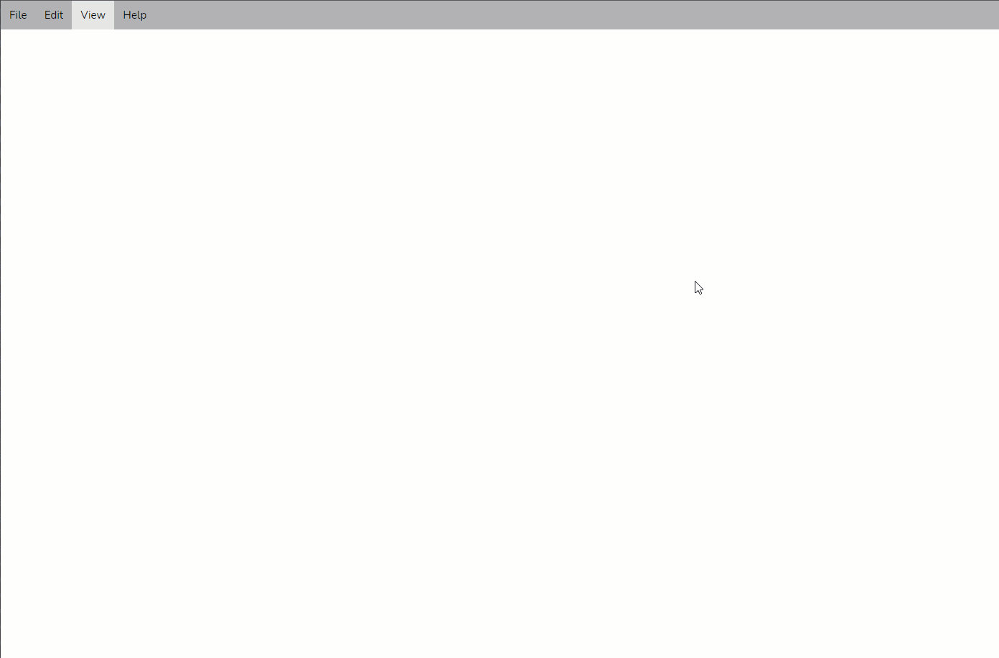
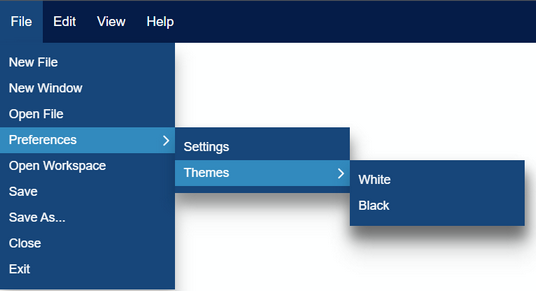
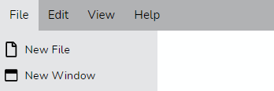

<div align="center">


[](https://github.com/vinayakkulkarni/v-dock-menu/actions/workflows/ci.yml)
[](https://deepscan.io/dashboard#view=project&tid=9055&pid=17446&bid=399662)
[](https://deepsource.io/gh/vinayakkulkarni/v-dock-menu/?ref=repository-badge)
[](https://snyk.io/test/github/vinayakkulkarni/v-dock-menu?targetFile=package.json)




</div>

<p>
  <a href="https://v-dock-menu.vinayakkulkarni.dev"><strong>Live demo →</strong></a>
</p>

<h2>Features</h2>

- ⚓ &nbsp;Dock your menu bar to the top, bottom, left or right edge.
- 🤏 &nbsp;Drag and drop the bar to any edge of the screen.
- 👆 &nbsp;Touch support.
- 👍 &nbsp;Nested menus to any depth.
- 👓 &nbsp;Menus adjust to the docked position.
- ⌨ &nbsp;Keyboard accessible, with ARIA `menubar` / `menu` roles.
- 🎨 &nbsp;Icon support through slots, and a themeable colour scheme.
- ⚡ &nbsp;Zero runtime dependencies.
- 💪 &nbsp;Built with [TypeScript](https://www.typescriptlang.org/) and Vue 3 `<script setup>`.

<h2>Table of Contents</h2>

- [⚡ Installation](#-installation)
- [🚀 Getting Started](#-getting-started)
- [Props](#props)
  - [⚓ Dock](#-dock)
  - [📡 on-selected](#-on-selected)
  - [⚡ Populating Menu](#-populating-menu)
  - [🎨 Custom color scheme](#-custom-color-scheme)
  - [🎭 Icon support](#-icon-support)
- [📦 Build Setup](#-build-setup)
- [🔨 Contributing](#-contributing)
- [📜 Notes](#-notes)
- [Meta](#meta)

## ⚡ Installation

```sh
pnpm add v-dock-menu
```

## 🚀 Getting Started

The following snippet creates a menu bar and docks it to the top of the page.

```vue
<script setup lang="ts">
  import { DockMenu, type SelectedItemModel } from 'v-dock-menu';
  import 'v-dock-menu/dist/index.css';

  const items = [
    {
      name: 'File',
      menu: [{ name: 'Open' }, { name: 'New Window' }, { name: 'Exit' }],
    },
    {
      name: 'Edit',
      menu: [{ name: 'Cut' }, { name: 'Copy' }, { name: 'Paste' }],
    },
  ];

  const onSelected = ({ name, path }: SelectedItemModel) =>
    console.log(name, path);
</script>

<template>
  <DockMenu :items="items" :on-selected="onSelected" />
</template>
```

You can also register it globally:

```ts
import { createApp } from 'vue';
import DockMenuPlugin from 'v-dock-menu';
import 'v-dock-menu/dist/index.css';

createApp(App).use(DockMenuPlugin).mount('#app');
```


## Props

| Name          | Description                                                                   | Default |
| ------------- | ----------------------------------------------------------------------------- | ------- |
| items         | Data for the menu bar                                                         | —       |
| dock          | Docking position: `TOP`, `LEFT`, `RIGHT` or `BOTTOM`. Supports `v-model:dock` | `TOP`   |
| on-selected   | Callback called on a menu item selection                                      | —       |
| draggable     | Enables dragging the menu bar to an edge                                      | `false` |
| theme         | Colour scheme (see below)                                                     | dark    |
| sidebar-width | Width of the expanded sidebar when docked left or right                       | `200px` |

The component also emits `selected` (same payload as `on-selected`) and `update:dock` when the bar is dragged to a new edge.

### ⚓ Dock

Use the `dock` prop to pick an edge. Bind it with `v-model:dock` to keep it in sync when users drag the bar.

```vue
<DockMenu v-model:dock="dock" :items="items" draggable />
```

### 📡 on-selected

The `on-selected` callback receives an object with a `name` and a `path`.

- **name** - Name of the selected menu item.
- **path** - Full path of the selected menu item.

Selecting `Copy` under the `Edit` menu gives:

```js
{ name: 'Copy', path: 'edit>copy' }
```

### ⚡ Populating Menu

Use the `items` prop to create simple or nested menus.

- To include a divider, add an item with just `isDivider: true`.
- To disable an item, set `disable: true`.
- To nest a menu, give an item its own `menu` array.

```ts
const items = [
  {
    name: 'File',
    menu: [
      { name: 'New' },
      { isDivider: true },
      {
        name: 'Open Recent',
        menu: [{ name: 'Roadmap' }, { name: 'Changelog' }],
      },
      { isDivider: true },
      { name: 'Save', disable: true },
      { name: 'Exit' },
    ],
  },
];
```

### 🎨 Custom color scheme

Use the `theme` prop to customise the colours. Any CSS colour works, including `var(--token)`.

```vue
<DockMenu
  :items="items"
  :theme="{
    primary: '#001B48',
    secondary: '#02457a',
    tertiary: '#018abe',
    textColor: '#fff',
  }"
/>
```



### 🎭 Icon support

Each menu item can take an icon through a slot. Set `iconSlot` on the item and pass a template with the same slot name. This works at every nesting level.

```vue
<DockMenu
  :items="[{ name: 'File', menu: [{ name: 'New File', iconSlot: 'file' }] }]"
>
  <template #file>
    
  </template>
</DockMenu>
```



## 📦 Build Setup

Requires Node 26 and pnpm.

```bash
pnpm install         # install dependencies
pnpm run build       # package the library (vp pack)
pnpm run test        # unit tests (vp test)
pnpm run lint        # vp lint
pnpm run typecheck   # vue-tsc for the library and the demo
pnpm run demo:dev    # run the Nuxt demo locally
pnpm run deploy      # deploy the demo to Cloudflare Workers
```

## 🔨 Contributing

1. Fork it ( [https://github.com/vinayakkulkarni/v-dock-menu/fork](https://github.com/vinayakkulkarni/v-dock-menu/fork) )
2. Create your feature branch (`git checkout -b new-feature`)
3. Commit your changes (`git commit -am 'Add feature'`)
4. Push to the branch (`git push origin new-feature`)
5. Create a new Pull Request

## 📜 Notes

This is a fork of the original [vue-dock-menu](https://github.com/prabhuignoto/vue-dock-menu) by [prabhuignoto](https://github.com/prabhuignoto) which supports Vue 2. This version targets Vue 3.

## Meta

Distributed under the MIT license. See `LICENSE` for more information.

[https://github.com/vinayakkulkarni/](https://github.com/vinayakkulkarni/)

[vue]: https://vuejs.org
[typescript]: https://typescriptlang.org
